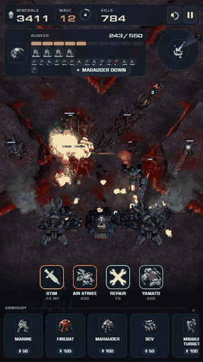
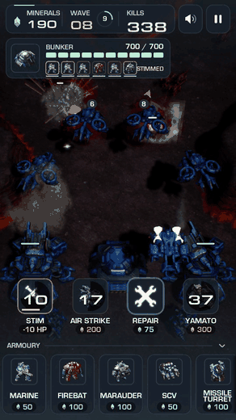
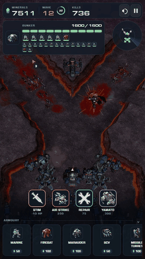
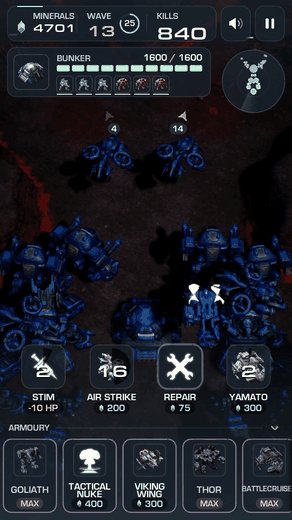
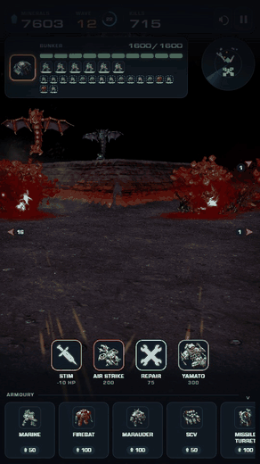
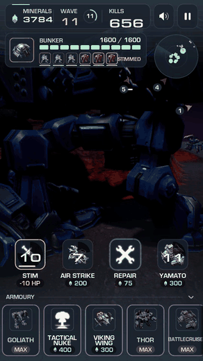
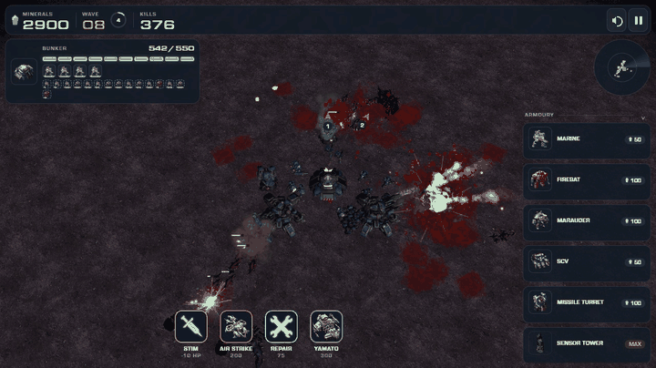
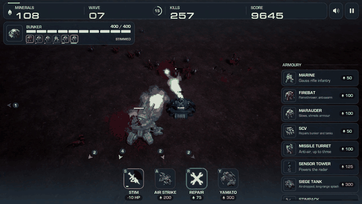

# Bunker Survivors

One bunker, a Terran fireteam, and the Swarm. Hold a chokepoint against ever-growing Zerg waves with marines,
firebats, marauders, SCVs, air-dropped siege tanks, missile turrets, banshee strikes and a Yamato cannon in orbit.
Plays in portrait on a phone (lane defence) and in a desktop browser (a harder 360-degree arena too).

The game renders **real StarCraft II models, animations, effects, icons, sounds and fonts**, read on demand from
**your own StarCraft II install** by a small companion server. The repository contains no Blizzard asset files
(the GIFs below are recordings of the game running) and nothing is extracted to disk for the browser version: you
need your own copy of StarCraft II (the free Starter Edition is enough).

There are two versions:

| | Browser version | Unreal Engine version |
| --- | --- | --- |
| Runs on | Windows or macOS (the PC/Mac with StarCraft II), played in any WebGL browser on it or on a phone | Windows only (built with Unreal Engine 5.8), streamed to phones and browsers with Pixel Streaming |
| Setup | Node.js, then one command | Unreal Engine, Visual Studio and a build; see [Unreal/README.md](Unreal/README.md) |
| Where | `client/` + `server/` | `Unreal/` |

Both play the same game: they share unit stats, waves, terrain and rules, and features land in both.

| | Browser version | Unreal Engine version |
| --- | --- | --- |
| **Lane defence** (phone, portrait): squad behind the bunker, siege tanks, stim and the banshee strike |  |  |
| **High-tech reinforcements**: goliaths, thors, the Odin, a battlecruiser on station and a tactical nuke |  |  |
| **Bunker view**: 360 degrees from inside the bunker (tap the bunker on the squad card) |  |  |
| **Arena** (desktop, landscape): zerg from every side |  |  |

## Quick start: browser version

### 1. Install StarCraft II and Node.js

- **StarCraft II** from Battle.net (any recent 5.x build; the free Starter Edition is fine). Let it finish
  installing; you do not need to launch it.
- **Node.js 18 or newer** from <https://nodejs.org> (on a Mac, `brew install node` also works).

### 2. Get this repository

Download it as a ZIP from GitHub and unzip it, or clone it:

```bash
git clone https://github.com/smerwin/bunker-survivors.git
```

### 3. Start it

**Windows:** double-click `start.cmd`.

**macOS:** double-click `start.command`. The first time, macOS may say it is from an unidentified developer:
right-click it, choose **Open**, then **Open** again. If Finder opens it in a text editor instead, run it from
Terminal:

```bash
cd bunker-survivors
./start.command
```

Either launcher installs the dependencies on first run, starts the companion server and opens
`http://localhost:8642/` in your browser. Leave its window open while you play; close it (or press `Ctrl+C`) to stop.

You can also do the same by hand on either system:

```bash
npm install
npm start
```

### 4. Play on your phone (optional)

Keep the phone on the same Wi-Fi as the computer and open one of the addresses the server prints, such as
`http://your-pc.local:8642/` or `http://192.168.1.20:8642/`. For a QR code to scan instead, open
`http://localhost:8642/qr.svg` on the computer.

- **Windows:** when Windows Firewall asks about Node.js, allow it on **private** networks.
- **macOS:** when asked whether `node` may accept incoming connections, click **Allow**.

Anyone who can reach that address can play, so only run it on networks you trust. To play away from home, use a
private network such as [Tailscale](https://tailscale.com) and run `HOST=<your tailscale IP> npm start` (on
Windows: `set HOST=100.x.y.z` then `npm start`) so the game only listens there.

### If StarCraft II is somewhere else

The server looks in the usual places (`C:\Program Files (x86)\StarCraft II`, `C:\Program Files\StarCraft II`,
`StarCraft II` / `Games\StarCraft II` on drives C to F, `/Applications/StarCraft II` and `~/Applications/StarCraft II`).
If yours is elsewhere, point `SC2_DIR` at the folder that contains `.build.info` and `SC2Data`:

```bash
# macOS
SC2_DIR="/Volumes/Games/StarCraft II" npm start
```

```bat
rem Windows
set SC2_DIR=E:\Blizzard\StarCraft II
npm start
```

### First run

- Loading takes a few seconds while the server opens StarCraft II's storage; models stream in as the first wave
  arrives.
- The first time an effect is needed, the server downloads the M3 file layout description from the
  [m3addon](https://github.com/SC2Mapster/m3addon) project into `server/vendor/` (one small XML file; internet
  needed once).
- Port 8642 in use? Run with `PORT=8700 npm start` (Windows: `set PORT=8700`).

## How to play

Zerg pour down the lane toward your bunker. Every kill pays minerals; spend them between and during waves. Every
fifth wave is a heavy assault. When the bunker falls, the run is over.

**The lane** is a Y-shaped chokepoint: zerg come down from the north and along the north-east and north-west arms.
Ranged zerg sometimes climb the ramps to the ledges overlooking the bunker, where they get extra reach and a third of
your bunker's shots at them miss. Flyers ignore the cliffs.

**Troops.** The bunker holds four (six with Neosteel Frame). Buy marines (anti-everything), firebats (anti-swarm,
ground only) or marauders (slow and shred armoured targets, ground only); a medivac drops them off and they walk in.
When the bunker is full, new recruits stand behind it, up to 48.
- Tap a soldier's portrait on the squad card to send them out of the bunker; tap one in the row underneath to bring
  them back in.
- Soldiers outside shoot from where they stand (without the bunker's range bonus) and advance on any zerg that is
  attacking you from beyond their reach. They are exposed, so they die more easily, but they cost little and buy time.

**Abilities**

| Ability | Cost | What it does |
| --- | --- | --- |
| Stim | free (HP) | +50% fire rate for 11 s. Costs every soldier 10 HP (marauders 20); anyone with that little left dies. Research Stimpack first. |
| Air strike | 200 | Four banshees hover over the ledges and the lane for 14 s, firing missiles at ground zerg. |
| Repair | 75 | Restores 150 bunker HP at once. |
| Yamato | 300 | A battlecruiser in orbit fires on the densest pack of zerg. |

**Armoury**

| Item | Notes |
| --- | --- |
| SCV (50) | Repairs the bunker, siege tanks and turrets automatically (repairs cost minerals). Up to four. |
| Missile turret (100) | Anti-air only. Up to three. |
| Sensor tower (125) | The radar only works while one stands. |
| Siege tank (300 for the first two, then +100 each) | Air-dropped; long-range splash against ground. Up to four. A destroyed tank can be replaced. |
| Upgrades | Infantry Weapons, Vehicle Weapons and Building Armor (many levels), Stimpack, Neosteel Frame (six slots), Hi-Sec Auto Tracking (+1 range), Magnetic Rails (+2 bunker range; needs Hi-Sec), Medivac on Station (heals soldiers and SCVs; needs Stimpack). |

**High-tech reinforcements.** Max out a tech tree and a surprise card appears at the front of the armoury:

| Card | Unlocked by | What it does |
| --- | --- | --- |
| Goliath (250, up to 4) | Vehicle Weapons maxed | Walkers at the bunker's shoulders: autocannons against ground, missiles against air. |
| Tactical Nuke (400) | Infantry Weapons maxed | A ghost calls a nuke on the densest pack clear of the bunker. 45 s to reload. |
| Viking Wing (300) | every bunker system (Stimpack, Neosteel, Hi-Sec, Magnetic Rails, Medivac) | Four fighters patrol overhead for 20 s, hunting air. |
| Thor (600, up to 2) | Building Armor maxed | Heavy walkers firing long-range from behind the bunker. |
| Battlecruiser (1500) | every tree maxed | Parks nose-south over the fork of the lane: six laser turrets on its hardpoints pick their own targets, plus missile pods and an automatic Yamato. |
| Odin (2500) | the battlecruiser on station | Heavy artillery from behind the bunker. |

To try them without the grind, open the game with `?tech=max` (for example `http://localhost:8642/?mode=lane&tech=max`):
it researches everything and banks minerals.

**Bunker view.** Tap the bunker picture on the squad card (or press `V`) to look out from inside the bunker; drag to
look all the way round and pinch to zoom. Tap it again for the overhead view.

## Controls

| Action | Phone | Desktop |
| --- | --- | --- |
| Focus fire | tap a zerg | click a zerg |
| Pan (turn, in bunker view) | drag | drag or arrow keys |
| Zoom | pinch | mouse wheel or `+` / `-` |
| Reset camera | double-tap | double-click or `Home` |
| Bunker view on / off | tap the bunker picture | `V` |
| Stim / Air strike / Repair / Yamato | ability buttons | `S` / `A` / `R` / `Y` |
| Pause | pause button | `P` or `Esc` |
| Rotate camera (arena) | two-finger twist (Unreal) | `Q` / `E` |
| Start lane / arena | mode buttons | `1` / `2` |

## Troubleshooting

| Problem | Fix |
| --- | --- |
| "Could not find a StarCraft II install" | Set `SC2_DIR` (see above). The folder must contain `.build.info`. |
| Phone cannot connect | Same Wi-Fi as the computer? Allow Node.js through the firewall (Windows) or accept incoming connections (macOS). Some guest and office networks block devices from seeing each other. |
| Units are missing or invisible | Let the first wave stream in; refresh if a model failed to load. Check the server window for errors. |
| Choppy on a phone | Lane mode in portrait is lighter. The game already lowers its resolution and zerg cap on phones. |

## How it works

- `server/casc.js` reads StarCraft II's local CASC storage (`.idx` indices, encoding table, BLTE decoding) in plain
  Node.js; `server/mndx.js` is a JavaScript port of CascLib's MNDX root parser (the file-name trie StarCraft II uses).
- `server/index.js` serves the game and `/asset/<path>` (decoded files), `/icon/<name>.png` (button icons decoded
  from DDS), `/fx/<effect>.json` (particle emitters extracted from M3 effect models by `server/m3fx.js`) and converts
  IMA-ADPCM sounds to PCM so browsers can play them. Models, textures and effects are gzipped on the wire.
- `client/` is a plain JavaScript game on top of [mdx-m3-viewer](https://github.com/flowtsohg/mdx-m3-viewer)
  (WebGL M3 renderer, patched by `scripts/patch-viewer.js` for newer StarCraft II material versions) with its own
  particle player, terrain (`client/js/terrain.js`) and HUD.
- `scripts/export-assets.js` converts the same assets into files for the Unreal version (see its README). Those
  exports are derived from your copy of the game: they are gitignored and must not be shared.

## License

Public domain ([Unlicense](LICENSE)). The code was written by AI coding tools under human direction, so there may
be no copyright in it at all; whatever there is has been given away. Third-party code bundled here keeps its own
license: see [THIRD_PARTY_NOTICES.md](THIRD_PARTY_NOTICES.md).

## Credits

- CascLib by Ladislav Zezula (MIT): `server/mndx.js` is a port of its MNDX root parser.
- mdx-m3-viewer by Chananya Freiman (MIT), bundled as `client/lib/viewer.min.js`.
- M3 structure definitions from the m3addon project (GPL-2.0), downloaded at run time and not redistributed here.
- StarCraft II and its assets are trademarks and property of Blizzard Entertainment. This is an unofficial fan
  project that only works with your own copy of the game.
